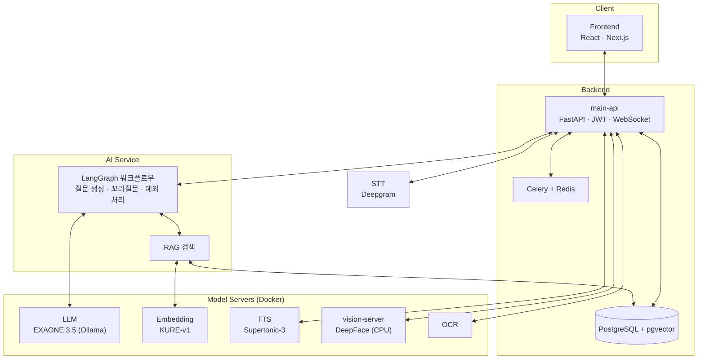
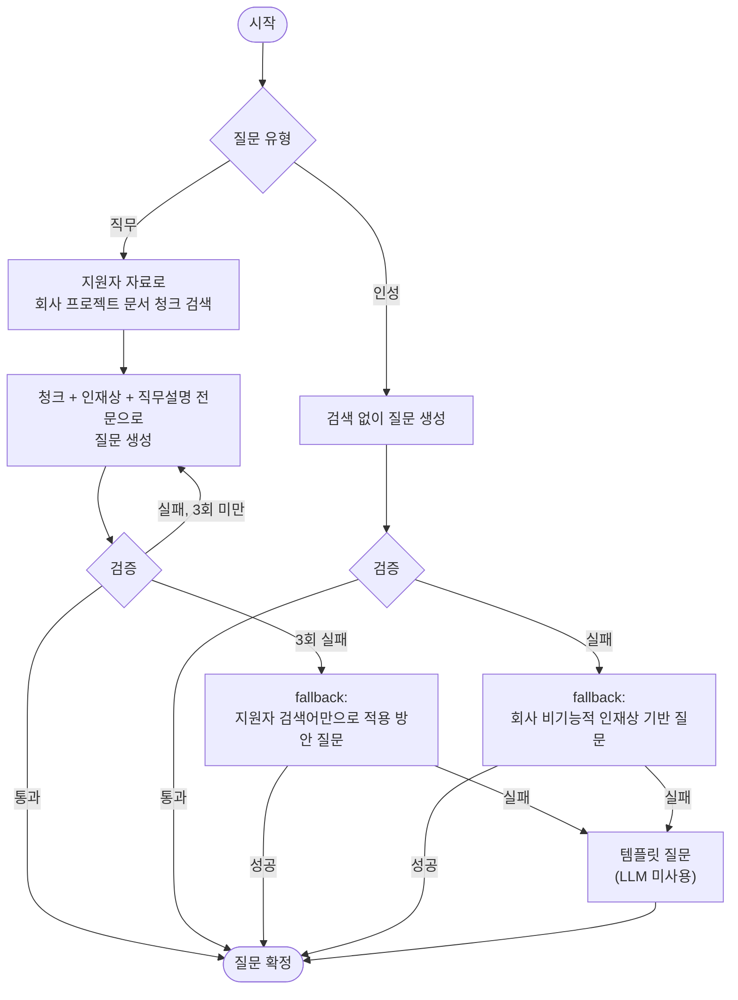
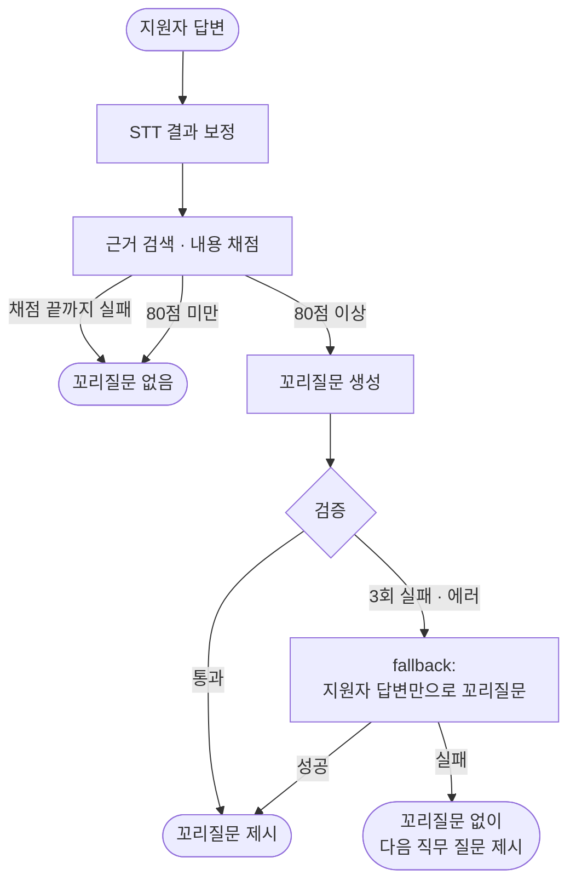
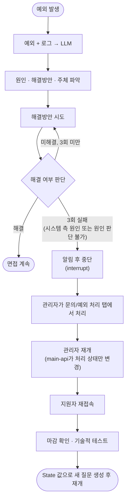

# AI top-pick.

> LangGraph 기반 채용 자동화 솔루션

AI top-pick.은 채용 회사의 **서류 전형**과 **AI 화상면접 전형**을 자동화하는 솔루션입니다.
지원자 자료와 회사 문서를 RAG로 연결해 면접 질문을 만듭니다.
면접 중에는 답변을 듣고 꼬리질문을 생성합니다.
전형이 마감되면 AI가 평가 보고서를 자동으로 만듭니다.

<!-- TODO: 로고 이미지 경로 -->
<!-- <p align="center"></p> -->

| 분류 | 기술 |
|---|---|
| **AI / LLM** |    |
| **Backend** |     |
| **DBMS** |     |
| **Frontend** |    |
| **DevOps** |  |
| **Collaboration** |   |

---

## 목차

1. [프로젝트 개요](#프로젝트-개요)
2. [주요 기능](#주요-기능)
3. [채용 프로세스](#채용-프로세스)
4. [시스템 아키텍처](#시스템-아키텍처)
5. [기술 스택](#기술-스택)
6. [AI 워크플로우 (LangGraph)](#ai-워크플로우-langgraph)
7. [RAG 설계](#rag-설계)
8. [인프라 구성](#인프라-구성)
9. [주요 의사결정](#주요-의사결정)
10. [개발 순서](#개발-순서)
11. [실행 방법](#실행-방법)
12. [화면](#화면)
13. [설계 문서](#설계-문서)

---

## 프로젝트 개요

| 항목 | 내용 |
|---|---|
| 프로젝트명 | AI top-pick. |
| 형태 | 1인 프로젝트 (포트폴리오용, 비상업) |
| 사용자 | 채용 회사 관리자, 지원자 |
| 전형 구성 | 1차 서류 전형 → 2차 면접 전형 |
| 개발 방식 | 애자일 (공통 분석·설계 → 기능별 설계·구현) |
| 일정 관리 | Jira |
| 개발 기간 | 2026.10.23. ~ 2026.11.19. |

---

## 주요 기능

### 관리자

- **채용공고 등록·수정**
  - 등록·수정 전에 작성 내용 검토 페이지를 거칩니다.
  - 면접 질문의 직무/인성 비율을 공고에서 정합니다.
- **대시보드**
  - 상단 드롭다운에서 자신의 공고를 선택합니다.
  - 선택한 공고의 공고 요약, 평가기준 요약, 전형 현황(서류/면접), 내 할 일을 보여줍니다.
  - 각 박스를 누르면 상세 페이지로 이동합니다.
  - 오류 수는 `AI 미처리` + `관리자 대기` 건수입니다.
- **서류·면접 전형 평가**
  - 채용공고 상세에서 각 전형 종료 후 평가 화면으로 들어갑니다.
  - AI가 만든 지원자별 보고서를 확인합니다.
  - 관리자 의견을 등록할 수 있습니다. (선택 사항)
- **문의/예외 처리**
  - AI가 해결하지 못한 면접 중 예외를 확인하고 처리합니다.
  - 처리 후 지원자의 응시를 재개합니다.

### 지원자

- **지원서 제출**: 이력서, 자기소개서, 포트폴리오, 기술 적용 사례
- **AI 화상면접 응시**
  - 질문은 TTS 음성으로 제시됩니다.
  - 답변은 STT로 텍스트화됩니다.
- **재시험**
  - 같은 응시를 이어서 진행합니다. (이전 질문·답변 유지)
  - 횟수 제한은 없습니다. 시스템 측 오류일 수 있기 때문입니다.
  - 마감이 지나면 응시할 수 없습니다.
- **결과 조회**: 합격자 선정 후 지원자가 직접 조회합니다.

### AI

- 서류·면접 전형 마감 시 결과 보고서 자동 생성
- RAG 기반 맞춤형 면접 질문 생성
- 실시간 꼬리질문 생성
- 표정(감정) 분석
- STT 결과 기반 간투사·답변 지연 단서 분석 (부가 지표)
- 면접 중 예외 처리 챗봇

---

## 채용 프로세스

```mermaid
flowchart LR
    A["채용공고 작성"] --> B["작성 내용 검토"]
    B --> C["공고 등록"]
    C --> D["지원서 접수"]
    D --> E["서류 전형 마감"]
    E --> F["AI 서류 보고서 자동 생성"]
    F --> G["관리자 검토·의견 등록(선택)"]
    G --> H["서류 합격자 선정"]
    H --> I["AI 화상면접 응시"]
    I --> J["면접 전형 마감"]
    J --> K["AI 면접 보고서 자동 생성"]
    K --> L["관리자 검토·의견 등록(선택)"]
    L --> M["최종 합격자 선정"]
    M --> N["지원자 결과 조회"]
```



---

## 시스템 아키텍처

메인 API와 AI 서비스·모델 서버를 분리한 **AI 서비스 분리형** 구조입니다.



> 위 다이어그램은 논리 구조입니다. 실제 호출 경로는 구현 코드 기준으로 수정이 필요합니다.

---

## 기술 스택

| 구분 | 기술 |
|---|---|
| Backend | FastAPI, JWT, WebSocket, Celery, Redis |
| Frontend | React, Next.js |
| Database | PostgreSQL, pgvector |
| AI Orchestration | LangChain, LangGraph |
| LLM (On-Premise) | EXAONE 3.5 (Ollama) — 테스트 중 |
| Embedding | KURE-v1 |
| STT | Deepgram |
| TTS | Supertonic-3 |
| Vision | DeepFace |
| 문서 이미지 분석 | OCR |
| Infra | Docker, Docker Compose |
| Design | Figma |
| 협업·일정 | Jira, Notion |

---

## AI 워크플로우 (LangGraph)

LangGraph는 세 곳에서 사용합니다.
질문 생성은 분기와 반복이 많아 LangChain 체인 대신 LangGraph로 구성했습니다.

### ① 면접 질문 생성

- 공고에서 정한 직무/인성 비율대로 질문을 생성합니다.
- 직무 질문은 RAG 검색을 거칩니다.
- 인성 질문은 검색 없이 생성·검증합니다.
- 검증은 생성과 다른 세션에서 수행합니다.
- 검증 기준은 **근거 적합성**과 **질문 간 배타성**입니다.



- 재생성 시 검증 피드백을 함께 넘깁니다.
- 템플릿 문장 틀은 공고 등록 직후 인재상을 질문하기 좋은 형태로 바꿔 둡니다.
- 이력서는 개인정보 확인용이라 검색에 쓰지 않습니다.
- 질문 배타성 판단에 기술·역량 태그는 쓰지 않습니다. 직무 기술을 태그로 상세히 담기 어렵기 때문입니다.

### ② 꼬리질문 생성

- 꼬리질문은 **직무 질문에만** 생성합니다.
- 답변 STT를 먼저 보정합니다.
- 보정한 답변으로 근거를 검색하고 점수를 냅니다.
- 점수가 **80점 이상**일 때 꼬리질문을 생성합니다.



- 에러 횟수와 검증 실패 횟수는 따로 셉니다.
- 무효 꼬리질문 재생성은 직전 답변을 기준으로 합니다.

### ③ 면접 중 예외 처리

- 챗봇이 예외와 로그를 LLM에 보냅니다.
- 로그 범위는 현재 질문 시작부터 지금까지입니다.
- LLM은 원인, 해결방안, 처리 주체를 파악합니다.



- 해결 여부는 혼합 방식으로 판단합니다.
  - 시스템 재검사가 가능하면 시스템이 판단합니다.
  - 불가능하면 지원자 확인으로 판단합니다.
- 3회는 해결방안대로 시도했지만 실패한 횟수입니다.
- 관리자 재개는 그래프를 호출하지 않습니다. 그래프는 재접속 대기 interrupt에서 멈춰 있습니다.
- 재시험 질문은 답변 시간을 처음부터 줍니다.

#### 관련 데이터 규칙

- `interview_session.application_id`는 UNIQUE입니다. (지원서당 응시 1개)
- `interview_session.ended_at`은 응시 완료 때만 기록합니다.
- '완료'가 아닌 응시의 체크포인트는 지우지 않습니다.
- 체크포인트가 없는 진행 중·중단 응시는 오류로 처리합니다.
- `inquiry` 테이블에 처리 상태, 처리 시각, AI 시도 횟수를 관리합니다.

---

## RAG 설계

### 색인 대상 (회사 정보)

- 인재상
- 회사 프로젝트 문서
- 직무 설명

### 검색 쿼리 (지원자 정보)

- 포트폴리오
- 자기소개서
- 기술 적용 사례
- 면접 답변 (STT 보정 후)

### 구성

- 임베딩: KURE-v1
- 벡터 저장소: PostgreSQL + pgvector
- 벡터 관련 테이블은 기존 테이블 명세서에 함께 정의합니다. PostgreSQL 생성 스크립트를 일관되게 관리하기 위해서입니다.
- 포트폴리오 이미지(아키텍처도 등)는 VLM 대신 OCR로 텍스트를 추출합니다.

### 개선 과정

기본 RAG를 먼저 구현하고 평가합니다.

평가 결과에서 부족한 부분을 개선하고, 개선 정도를 확인합니다.

| 단계 | 적용 기법 | 평가 결과 |
|---|---|---|
| Baseline | 기본 RAG | <!-- TODO --> |
| 개선 1 | 청크 크기 축소 | <!-- TODO --> |
| 개선 2 | Contextual Retrieval | <!-- TODO --> |
| 개선 3 | Reranker | <!-- TODO --> |

<!-- TODO: 평가 지표(예: Recall@k 등)와 평가 데이터셋 설명 -->

---

## 인프라 구성

AI 모델 서버를 컴퓨터 2대에 Docker로 나누어 운영합니다.

| 항목 | 사양 |
|---|---|
| 서버 | PC 2대 |
| RAM | 각 32GB |
| GPU | 각 GTX 1660 SUPER (6GB) |

- LLM은 PC2의 Ollama에서 실행합니다.
- vision-server(DeepFace)는 CPU로 실행합니다. 1분 영상이 약 3초에 분석됩니다.
- 6GB VRAM 안에서 더 큰 LLM(EXAONE 3.5 7.8B)을 GPU에 모두 올리는 방법을 시도 중입니다.

<!-- TODO: PC1/PC2별 컨테이너 배치표 -->

---

## 주요 의사결정

| 결정 | 이유 |
|---|---|
| AI 서비스 분리형 아키텍처 | 개발 일정이 길어질 것으로 예상되어 메인 API와 AI 서비스·모델 서버를 분리 |
| 코딩테스트 전형 제외 | <!-- TODO: 이유 --> 2차 전형은 면접 전형만 남김 |
| 질문 생성을 LangGraph로 전환 | 분기·반복이 생겨 LangChain 체인 대신 LangGraph 사용 |
| 다단계 fallback 설계 | <!-- TODO: 이유 --> 검증 실패 시 fallback → 템플릿 질문 순으로 대체 |
| VLM 대신 OCR | VLM 동시 적재 문제, 흐름 인식 정확도 문제 |
| 음성 운율 분석 제외 | <!-- TODO: 이유 --> |
| Vision 서버 CPU 실행 | 1분 영상이 약 3초에 분석됨 |
| 온프레미스 LLM: EXAONE | 한국어 문서 처리 기대, 성능 평가 우수 (중국 모델은 후보에서 제외) |
| RAG 단계적 개선 | 기본 RAG 평가 후 청크 축소, Contextual Retrieval, Reranker 적용 |

---

## 개발 순서

1. Docker Compose 뼈대 구성, 모든 서버 `/health` 연결
2. 모델 서버 단독 테스트
3. main-api 인증·CRUD
4. 회사 문서 임베딩 → RAG 검색
5. 면접 질문 생성
6. 실시간 면접 흐름 (STT 보정, 표정 분석, 문의 처리)
7. 서류·면접 보고서 체인
8. 통합 테스트

---

## 실행 방법

<!-- TODO: 실제 레포 구조와 환경변수에 맞게 작성 -->

```bash
# 1. 저장소 클론
git clone <repository-url>
cd <repository-name>

# 2. 환경변수 설정
cp .env.example .env   # TODO: 실제 파일명 확인

# 3. 컨테이너 실행
docker compose up -d
```

---

## 화면

액티비티 다이어그램을 기준으로 화면 26개를 도출했습니다.
화면은 Figma로 제작합니다.

<!-- TODO: 주요 화면 캡처 -->
<!--
| 관리자 대시보드 | 채용공고 상세 | AI 화상면접 |
|---|---|---|
|  |  |  |
-->

---

## 설계 문서

<!-- TODO: 노션 공개 링크 -->

- 벡터 DB 설계서
- RAG 설계서
- AI Agent 설계서 (Task, Workflow: State · Node · Edge · Interrupt)
- 테이블 명세서

---

## 비고

- 본 프로젝트는 포트폴리오용이며 상업적 목적이 없습니다.
